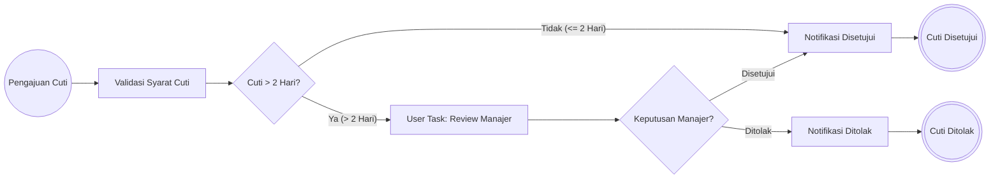

# UTS Rekayasa Perangkat Lunak Lanjut: Implementasi BPMN dengan Spring Boot & Camunda

**Mata Kuliah:** Rekayasa Perangkat Lunak Lanjut  
**Dosen Pengampu:** Rizal Broer, M.Kom (`rizalbroer@uinjkt.ac.id`)  
**Teknologi:** Java 21, Spring Boot 3.3.6, Camunda BPM 7.22.0, Jakarta EE, H2 In-Memory Database  

---

## Daftar Isi
1. [Jawaban Soal 1: Analisis 5W Spring Boot & BPMN pada J2EE](#1-jawaban-soal-1-analisis-5w-spring-boot--bpmn-pada-j2ee)
2. [Jawaban Soal 2: Konfigurasi Tools & Pengujian Hello World](#2-jawaban-soal-2-konfigurasi-tools--pengujian-hello-world)
3. [Jawaban Soal 3: Studi Kasus - Sistem Pengajuan Cuti Karyawan](#3-jawaban-soal-3-studi-kasus---sistem-pengajuan-cuti-karyawan)
4. [Jawaban Soal 4: Panduan Print Screen & Rekaman Video](#4-jawaban-soal-4-panduan-print-screen--rekaman-video)
5. [Jawaban Soal 5: Penerapan Prinsip ABC dalam Dokumentasi](#5-jawaban-soal-5-penerapan-prinsip-abc-dalam-dokumentasi)
6. [Jawaban Soal 6: Dokumentasi Git & Kolaborasi GitHub](#6-jawaban-soal-6-dokumentasi-git--kolaborasi-github)

---

## 1. Jawaban Soal 1: Analisis 5W Spring Boot & BPMN pada J2EE

Analisis menggunakan pendekatan **5W (What, Why, Who, Where, When)**:

### A. Spring / Spring Boot Framework
* **What (Apa):** Framework aplikasi enterprise berbasis Java/Jakarta EE yang menyediakan arsitektur *Dependency Injection* (DI), *Inversion of Control* (IoC), serta konfigurasi otomatis (*Auto-Configuration*) melalui modul starter tanpa konfigurasi XML yang rumit.
* **Why (Mengapa):** Mempercepat waktu pengembangan (*time-to-market*), mengurangi kode repetitif (*boilerplate code*), menyediakan embedded server (Tomcat/Jetty), dan memiliki ekosistem siap produksi (*production-ready*).
* **Who (Siapa):** Dikembangkan oleh tim Pivotal (kini Broadcom/VMware) dan digunakan oleh Software Engineer, Enterprise Backend Developer, serta Tim DevOps skala global.
* **Where (Di mana):** Digunakan pada arsitektur Microservices, RESTful API backend, sistem pemrosesan transaksi perbankan, dan aplikasi enterprise berbasis web.
* **When (Kapan):** Digunakan saat tim membutuhkan fondasi aplikasi enterprise yang kokoh, modular, mudah diuji (*testable*), dan siap untuk *continuous deployment*.

### B. Business Process Management (BPM) & BPMN 2.0
* **What (Apa):** 
  * **BPM:** Metodologi disiplin manajerial dan teknis untuk memodelkan, mengotomatisasi, mengeksekusi, serta memonitor alur kerja bisnis organisasi.
  * **BPMN 2.0 (*Business Process Model and Notation*):** Standar visual representasi alur proses bisnis internasional yang diakui oleh OMG (*Object Management Group*), memuat notasi standar seperti *Events*, *Tasks*, *Gateways*, dan *Data Objects*.
* **Why (Mengapa):** Menghubungkan jurang komunikasi (*gap*) antara Analis Bisnis non-teknis dan Software Engineer teknis, memvisualisasikan aturan bisnis kompleks, serta menghindari penulisan *hard-coded business logic* di kode Java.
* **Who (Siapa):** Digunakan oleh Business Analyst, System Analyst, Software Architect, dan Developer.
* **Where (Di mana):** Dijalankan di dalam *Process Engine* (seperti Camunda, Flowable, Activiti, jBPM) yang terpasang pada layer orkestrasi bisnis.
* **When (Kapan):** Diterapkan ketika sistem memiliki alur bisnis multi-langkah (*multi-step*), melibatkan interaksi manusia (*Human-in-the-loop / User Task*), SLA waktu, persetujuan bertingkat, atau alur transaksi yang sering berubah.

### C. Keterkaitan Keduanya & Manfaat BPM dalam J2EE / Jakarta EE
1. **Pemisahan Logika Bisnis (*Separation of Concerns*):**
   * Alur proses (aturan urutan, gateway keputusan, SLA) didelegasikan ke BPMN.
   * Logika teknis (akses database, enkripsi, integrasi API) ditulis dalam Spring Beans / Jakarta EE services.
2. **Eksekusi Native via Service Task & Inversion of Control:**
   * Node dalam diagram BPMN dapat langsung mengeksekusi Spring Bean via ekspresi delegate `${namaBean}`, memadukan kekuatan visual BPMN dengan keandalan Java.
3. **Visibilitas dan Audit Trail Real-time:**
   * Di J2EE konvensional, status alur tersimpan di tabel database manual. Dengan BPM Engine (Camunda), status instance, histori, dan token proses dipantau secara grafis via Camunda Cockpit.
4. **Manajemen Transaksi Terpadu (*ACID Support*):**
   * Camunda terintegrasi langsung dengan `PlatformTransactionManager` Spring Boot dan JPA / Jakarta Transactions.

---

## 2. Jawaban Soal 2: Konfigurasi Tools & Pengujian Hello World

### A. Komponen & Versi Tools
| Komponen | Tools / Versi | Keterangan |
| :--- | :--- | :--- |
| **Bahasa Pemrograman** | Java 21 LTS | OpenJDK / Temurin |
| **Framework Backend** | Spring Boot 3.3.6 | Berbasis Jakarta EE 10 |
| **BPM Engine** | Camunda BPM 7.22.0 | Engine BPMN 2.0 & REST Starter |
| **Web UI BPM** | Camunda Webapp 7.22.0 | Cockpit, Tasklist, Admin |
| **Database** | H2 In-Memory Database | `jdbc:h2:mem:camunda` |
| **IDE & Modeling** | VS Code / Camunda Modeler | Editor kode & XML BPMN |

### B. Konfigurasi `application.properties`
```properties
spring.application.name=demo
server.port=8080

# Akun Administrator Camunda
camunda.bpm.admin-user.id=demo
camunda.bpm.admin-user.password=demo
camunda.bpm.admin-user.firstName=Demo
camunda.bpm.admin-user.lastName=Admin
camunda.bpm.filter.create=All tasks

# Database H2 In-Memory
spring.datasource.url=jdbc:h2:mem:camunda;DB_CLOSE_DELAY=-1;DB_CLOSE_ON_EXIT=FALSE
spring.datasource.driverClassName=org.h2.Driver
spring.datasource.username=sa
spring.datasource.password=
spring.h2.console.enabled=true
```

### C. Pembuktian Uji "Hello World"
1. **File BPMN:** `src/main/resources/helloworld.bpmn` (`id="ProsesHelloWorld"`, memanggil bean `${helloWorld}`).
2. **Java Delegate:** `HelloWorldDelegate.java` mengimplementasikan `JavaDelegate`.
3. **Endpoint Trigger:** `GET http://localhost:8080/test-hello`.
4. **Hasil Verifikasi:**
   * **HTTP Response:** `Proses Hello World Berhasil! Silakan cek terminal IDE Anda.`
   * **Console Log:**
     ```
     ==================================================
     HELLO WORLD! INSTALASI CAMUNDA & SPRING BOOT SUKSES!
     ==================================================
     ```

---

## 3. Jawaban Soal 3: Studi Kasus - Sistem Pengajuan Cuti Karyawan

### A. Deskripsi Kasus (*Business Use Case*)
Dalam suatu perusahaan, karyawan mengajukan permohonan cuti kerja melalui sistem. Aturan bisnis dirancang sebagai berikut:
1. **Start Event:** Karyawan mengisi formulir permohonan cuti (Nama, Departemen, Durasi Hari, Alasan).
2. **Service Task (Validasi Otomatis):** Sistem mengevaluasi durasi cuti.
   * **Jika cuti &le; 2 hari:** Kuota aman &rarr; **Auto-Approved** oleh sistem langsung tanpa persetujuan manajer.
   * **Jika cuti &gt; 2 hari:** Memerlukan persetujuan bertingkat &rarr; dialihkan ke **User Task** Manajer.
3. **User Task (Review Manajer):** Manajer memeriksa detail cuti di Camunda Tasklist atau Web Portal dan memutuskan:
   * **Disetujui:** Cuti diizinkan.
   * **Ditolak:** Cuti dibatalkan dengan catatan alasan penolakan.
4. **Exclusive Gateway (XOR Decision):** Mengarahkan token proses sesuai keputusan.
5. **Service Task (Notifikasi Status Akhir):** Mengirimkan notifikasi hasil keputusan dan mencatat ke log histori.
6. **End Event:** Proses selesai.

### B. Diagram Alur Proses BPMN (Mermaid Representation)


### C. Daftar File Sumber Daya
* **File BPMN 2.0:** [`pengajuan-cuti.bpmn`](file:///demo/src/main/resources/pengajuan-cuti.bpmn)
* **Delegate Validasi:** [`ValidasiCutiDelegate.java`](file:///demo/src/main/java/com/example/demo/ValidasiCutiDelegate.java)
* **Delegate Approval:** [`NotifikasiDisetujuiDelegate.java`](file:///demo/src/main/java/com/example/demo/NotifikasiDisetujuiDelegate.java)
* **Delegate Rejection:** [`NotifikasiDitolakDelegate.java`](file:///demo/src/main/java/com/example/demo/NotifikasiDitolakDelegate.java)
* **REST API Controller:** [`CutiController.java`](file:///demo/src/main/java/com/example/demo/CutiController.java)
* **Web Portal Frontend:** [`index.html`](file:///demo/src/main/resources/static/index.html)

### D. Daftar Endpoint REST API
| HTTP Method | URL Endpoint | Deskripsi |
| :--- | :--- | :--- |
| `POST` | `/api/cuti/ajukan` | Mengirim data formulir & memulai proses cuti baru |
| `GET` | `/api/cuti/tasks` | Mengambil daftar tugas manajer yang belum selesai |
| `POST` | `/api/cuti/tasks/{taskId}/review` | Mengirim aksi persetujuan (*approve* / *reject*) manajer |
| `GET` | `/api/cuti/history` | Mengambil seluruh histori instance proses dan variabel |

---

## 4. Jawaban Soal 4: Panduan Print Screen & Rekaman Video

### A. Panduan Pengambilan Print Screen (Tangkapan Layar)
Ambil tangkapan layar untuk 6 poin kunci berikut:
1. **Screenshot 1: Terminal Build & Server Started**
   * Tampilkan terminal VS Code saat menjalankan `.\mvnw.cmd spring-boot:run` hingga muncul log `Started DemoApplication` dan `Tomcat started on port 8080`.
2. **Screenshot 2: Uji Coba Hello World**
   * Browser mengakses `http://localhost:8080/test-hello` dengan respon teks sukses dan terminal IDE mencetak box `HELLO WORLD! INSTALASI CAMUNDA & SPRING BOOT SUKSES!`.
3. **Screenshot 3: Dashboard Web Aplikasi Pengajuan Cuti**
   * Buka browser ke `http://localhost:8080/` yang menampilkan form input pengajuan cuti, panel tugas aktif, dan tabel histori.
4. **Screenshot 4: Skenario Auto-Approve (&le; 2 Hari)**
   * Input nama karyawan dengan durasi 1 hari, klik Submit, dan perlihatkan status langsung menjadi `DISETUJUI (AUTO-APPROVED)`.
5. **Screenshot 5: Skenario Review Manajer (&gt; 2 Hari)**
   * Input nama karyawan dengan durasi 5 hari &rarr; masuk ke bagian "Persetujuan Cuti oleh Manajer", lalu lakukan persetujuan (*Approve* / *Reject*).
6. **Screenshot 6: Camunda Cockpit & Tasklist**
   * Buka `http://localhost:8080/camunda/app/cockpit/default/` (Login: `demo` / `demo`) untuk menunjukkan model `pengajuanCutiProcess` dan `ProsesHelloWorld` yang aktif.

### B. Panduan Skenario Rekaman Video (Screen Recording)
Gunakan OBS Studio atau Windows Game Bar (`Win + G`):
1. **Menit 00:00 - 00:30:** Pembukaan singkat, perkenalkan nama, NIM, mata kuliah RPL Lanjut.
2. **Menit 00:30 - 01:00:** Perlihatkan struktur file proyek di VS Code (`pom.xml`, file `.bpmn`, class delegate Java).
3. **Menit 01:00 - 01:45:** Jalankan Spring Boot dan demonstrasikan endpoint Hello World.
4. **Menit 01:45 - 03:00:** Buka web browser `http://localhost:8080/`, demokan kasus Auto-Approve (1 hari) dan kasus Review Manajer (> 2 hari).
5. **Menit 03:00 - 04:00:** Tunjukkan Camunda Cockpit dan riwayat proses yang telah berhasil dijalankan.

---

## 5. Jawaban Soal 5: Penerapan Prinsip ABC dalam Dokumentasi

Dokumentasi ini disusun mengacu pada **Prinsip ABC** (*Accuracy, Brevity, Clarity*):

1. **Accuracy (Akurat):**
   * Menggunakan fakta teknis yang valid: Maven dependency terverifikasi kompatibel (Spring Boot 3.3.6 + Camunda 7.22.0).
   * Notasi BPMN 2.0 valid XML sesuai spesifikasi OMG dengan atribut `camunda:delegateExpression` dan `camunda:historyTimeToLive`.
   * Endpoint REST menghasilkan HTTP response code dan JSON schema yang presisi.

2. **Brevity (Ringkas & Padat):**
   * Penyampaian langsung ke substansi tanpa pengulangan kata berlebih.
   * Menggunakan format tabel dan poin terstruktur untuk mempermudah perbandingan komponen.
   * Skema workflow disajikan secara padat dan efisien.

3. **Clarity (Jelas & Terstruktur):**
   * Alur tulisan disusun secara kronologis mulai dari fondasi teori (Soal 1) hingga dokumentasi kolaboratif (Soal 6).
   * Perintah baris kode (*code blocks*) dapat langsung di-*copy-paste* untuk direproduksi.
   * Pembagian peran antara sistem otomatis (*Service Task*) dan aktor manusia (*User Task*) dijelaskan secara eksplisit.

---

## 6. Jawaban Soal 6: Dokumentasi Git & Kolaborasi GitHub

### A. Langkah Inisialisasi Repository Git Lokal
Buka Terminal VS Code pada folder root workspace:
```powershell
# 1. Pastikan berada di root direktori project
cd "C:\Semester 5\rpl lanjut\UTS REAL\demo"

# 2. Inisialisasi git repository
git init

# 3. Tambahkan semua file yang tidak diabaikan oleh .gitignore
git add .

# 4. Buat initial commit
git commit -m "feat: complete UTS RPL Lanjut - Spring Boot Camunda BPMN Leave Request System"
```

### B. Membuat Repository di GitHub & Melakukan Push
1. Buka [GitHub.com](https://github.com) dan buat repository baru bernama `uts-rpl-lanjut-bpmn-springboot` (pilih opsi *Public* atau *Private*).
2. Hubungkan repositori lokal ke GitHub:
```powershell
git branch -M main
git remote add origin https://github.com/Kihatosi/uts-rpl-lanjut-bpmn.git
git push -u origin main
```

### C. Panduan Membagikan Akses ke Dosen (Pak Rizal Broer)
Jika repository diset sebagai **Private**:
1. Buka halaman repositori di GitHub.
2. Klik tab **Settings** (ikon gerigi).
3. Pilih menu **Collaborators** di bilah navigasi kiri.
4. Klik tombol **Add people**.
5. Masukkan email dosen: `rizalbroer@uinjkt.ac.id` (atau username GitHub beliau).
6. Klik **Add to this repository** untuk mengirim undangan kolaborasi.
7. Jika repository berstatus **Public**, tautan repositori dapat langsung dikirimkan ke email `rizalbroer@uinjkt.ac.id` beserta tautan video dan berkas laporan.

---

## Cara Menjalankan Aplikasi Secara Cepat

```powershell
# Masuk ke direktori Maven project
cd "C:\Semester 5\rpl lanjut\UTS REAL\demo\demo"

# Jalankan Spring Boot
.\mvnw.cmd spring-boot:run
```

Akses tautan berikut di browser:
* **Web Aplikasi Utama:** `http://localhost:8080/`
* **Camunda Webapp (Cockpit/Tasklist):** `http://localhost:8080/camunda/app/welcome/default/` (User: `demo`, Password: `demo`)
* **Uji Coba Hello World:** `http://localhost:8080/test-hello`
* **H2 Console:** `http://localhost:8080/h2-console`
